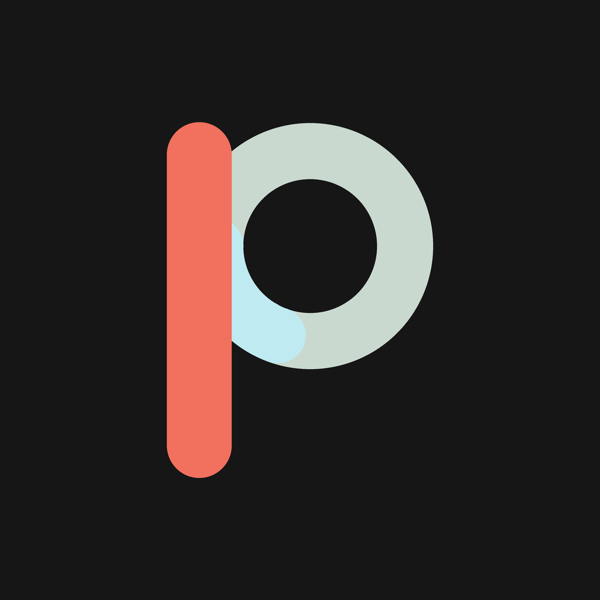

<p align="center"></p>

# Poora

**Make every day whole.** *Focus fully. Finish fully.*

Poora (पूरा, "whole, complete, done") is a calm focus timer and daily planner.
Offline-first, no account: everything stays on the phone.

- **Focus.** A Pomodoro timer with a distraction-free running screen. Your own reminders are held until
  you finish, and on Android it can switch the phone to Do Not Disturb (and always puts it back).
- **Tasks.** A day planner with Google-Calendar-style views (Day, 3 Day, Week, Month, Schedule), repeat
  rules (including "every other day" and "3 times a week"), reminders, and Done/Snooze from the notification.
- **Insights.** A completion calendar where each day's ring closes as you finish its tasks, plus streaks,
  recurring-task consistency, timing and focus stats.

Android first (min SDK 24), iOS 15+. Built with Flutter 3.47 / Dart 3.13.

## Brand

| | |
|---|---|
| Name | Poora (`AppInfo.name` in `lib/core/app_info.dart`, the only place it lives) |
| Tagline | Make every day whole. |
| Subline | Focus fully. Finish fully. |
| Mark | A **P** whose bowl is a completion ring that has just closed: coral stem (the action), sage ring (the day), ice closing stroke (the moment it's done). |
| Colours | Charcoal `#161616`, sage `#C9D9CF`, coral `#F2705E`, ice `#BFEAF2` |

The mark is drawn in code (`PooraMark`, `lib/core/widgets/poora_logo.dart`) and rendered to PNG for the
platforms by `tool/render_logo.py`. To change the logo:

```sh
python tool/render_logo.py assets/branding   # writes icon, adaptive layers, splash images
dart run flutter_launcher_icons              # Android mipmaps + adaptive/themed icon, iOS AppIcon
dart run flutter_native_splash:create        # native splash (incl. Android 12+ splash API)
```

### Store listing copy

- **Short description (80 chars):** Calm focus timer and day planner. Make every day whole.
- **Full description:**
  Poora helps you focus on one thing and finish your day. Start a focus session and the screen goes
  quiet: just the timer and a slow ring. Your reminders wait until you're done. Plan tasks with
  calendar-style repeats, tick them off, and watch each day's ring close. Everything stays on your
  phone. No account, no ads, no cloud.
- **Play icon:** `assets/branding/play_store_512.png`

## Develop

```sh
flutter pub get
dart run build_runner build      # Drift database code (lib/core/db/database.g.dart)
flutter run
flutter analyze                  # must be clean
flutter test                     # timer engine, occurrence generator, metrics, data reset
```

A component gallery is available in debug builds: Settings → About → Component gallery.

## Install (Android)

Download the latest APK from [Releases](../../releases): `poora-<version>-universal.apk` works on every phone.
Open it on your phone and allow "Install unknown apps" when asked. Android 7.0+.

## Releasing (GitHub)

Releases are built and signed by GitHub Actions (`.github/workflows/mobile-release.yml`, run from the repo root) when a version tag is pushed:

```sh
git tag v1.0.0
git push origin v1.0.0
```

The workflow analyzes, tests, builds a universal APK plus per-ABI APKs, refuses to publish anything
debug-signed, and attaches the APKs and `SHA256SUMS.txt` to a GitHub Release. Tags with a hyphen
(`v1.1.0-beta.1`) become pre-releases. The version shown in the app comes from the tag.

It needs four repository secrets (Settings → Secrets and variables → Actions): `ANDROID_KEYSTORE_BASE64`,
`ANDROID_KEYSTORE_PASSWORD`, `ANDROID_KEY_ALIAS`, `ANDROID_KEY_PASSWORD`. **Every release must be signed
with the same keystore**, or phones refuse to install the update; back it up somewhere safe.

`android/key.properties` (see `key.properties.example`) lets you build a signed release locally;
it and any `*.jks` are git-ignored.

## Project layout

Feature-first: `lib/core` (theme, widgets, DB, notifications, time), `lib/features/{home,focus,tasks,insights,settings,onboarding}`.
Domain logic (timer engine, occurrence generator, metrics) is pure Dart and unit-tested.
Design and behaviour decisions are recorded in [DECISIONS.md](DECISIONS.md).
